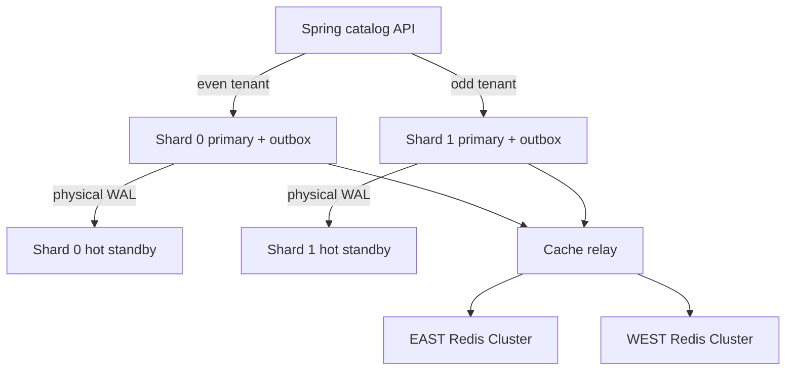

# Sharded PostgreSQL catalog with two regional Redis Clusters

Write a tenant's product once. The owning PostgreSQL shard commits the product and two pending cache updates in a single transaction. A worker delivers the latest version independently to EAST and WEST. Stop WEST to watch EAST continue serving updates.



Each PostgreSQL shard has one writable primary and one asynchronous, read-only physical standby. Different tenants can write concurrently to different primaries. Each regional Redis Cluster has three slot-owning nodes. The application writes a key once per region through a cluster-aware client. PostgreSQL remains authoritative.

## Run on Docker Desktop

Use Linux containers, Compose v2, WSL2/Bash, OpenSSL, curl and Python 3. The multi-stage image runs Maven tests with Java 17. Locally, a JDK 17 and Maven can run `mvn verify`.

```bash
git clone https://github.com/milindyadav777/spring-sharded-cache.git
cd spring-sharded-cache
./scripts/init-env.sh
docker compose up -d --build
python3 scripts/smoke.py
```

The smoke test writes to both shards, checks the other primary for absence, verifies hot standby recovery, and waits for hits in both caches. It temporarily stops the three WEST Redis nodes, writes a newer value, checks EAST and the replica fallback, then starts WEST and waits for convergence. It restores WEST on exit from the outage exercise.

```bash
curl -sS -X PUT localhost:8081/tenants/42/products/SKU-1 \
  -H 'Content-Type: application/json' -d '{"name":"blue mug"}'
curl -i 'localhost:8081/tenants/42/products/SKU-1?region=WEST'
curl -i 'localhost:8081/tenants/42/products/SKU-1?consistency=strong'
docker compose exec shard0-replica psql -U postgres -d catalog \
  -c 'SELECT pg_is_in_recovery(), pg_last_wal_replay_lsn()'
docker compose exec shard0-primary psql -U postgres -d catalog \
  -c 'SELECT tenant,sku,region,version,attempts,due_at FROM cache_job ORDER BY due_at'
```

| Operation | Routing and observable behavior |
| --- | --- |
| PUT | `tenant % 2` picks the primary. The transaction returns its committed version. Writes to the same SKU serialize on the row. Repeating PUT assigns another revision. |
| GET eventual | Regional Redis first, then that shard's read replica on a cache miss or Redis connection failure. The response header `X-Read-Source` identifies the path. A fresh write can briefly read as an old value or 404. |
| GET strong | Bypasses Redis and the standby, reads the owning primary. Use immediately after a write that must be visible. |
| Cache expiry | Keys expire after five minutes. Misses read the replica. A subsequent committed update warms both caches. Reads do not reinsert a stale replica value. |
| Replica unavailable | A cache hit can still succeed. A replica miss that requires the unavailable database fails. Strong reads remain available if its primary is up. |

## Trace a write

1. `ShardMap.java` owns the two primary/replica JDBC pools per pair. The JDBC driver checks the requested server role. `infra/standby.sh` bootstraps a physical standby with `pg_basebackup` and `standby.signal`.
2. `Catalog.java` writes the product plus one pending row per region in a shard-local transaction. The queue coalesces intermediate versions for the same key/region. It represents the desired cache state, rather than an audit history.
3. `CacheRelay.java` claims a due row with `FOR UPDATE SKIP LOCKED` and commits a 30-second lease before contacting Redis. A UUID fences completion and retry. A newer write clears the old claim. Crashes leave an expiring lease. Concurrent workers can drain different rows.
4. `RegionalCaches.java` uses a separate Lettuce connection factory per region. A single-key Lua update atomically compares the revision and stores the name plus TTL. Fixed-width decimal strings preserve the full positive BIGINT order. A retry with an older version cannot replace a newer resident value. Eviction, flush or failover can remove this version fence. Stale in-flight writes can then be temporarily visible until repair or expiry; use the primary read for stronger guarantees.
5. Failed sends retry with a capped delay. KEDA polls the number of due jobs on each primary with a read-only scaler role. Only the relay scales to zero. The API stays available to create work.

## A two-hour practice session

| Time | Exercise |
| --- | --- |
| 25 min | Write tenants 42 and 43, inspect both primaries and check recovery status on each standby. |
| 20 min | Compare a strong GET with both regional GETs using the read-source header. |
| 30 min | Stop the worker, write twice to one SKU, inspect two coalesced queue rows, restart and watch both regions catch up. |
| 30 min | Stop WEST, write again and observe EAST advancing. Restart WEST and check pending rows drain. |
| 15 min | Explain what happens after a worker crash before Redis, after Redis, and after the SQL acknowledgment. |

Redis gossip records numeric bus addresses. Compose reserves a stable IP per member; Kubernetes advertises one stable Service IP per member. If the default Docker subnet overlaps your network, set `LAB_NETWORK_PREFIX` in `.env` to an unused three-octet prefix before first start.

Pause with `docker compose stop` and resume with `docker compose start`. Keep the generated `.env` with its volumes.

## Kubernetes

With Docker, kind, kubectl, Helm 3, Bash and OpenSSL available, run from the repository root:

```bash
./scripts/kind-up.sh
```

The script uses the named kind context `kind-spring-labs`, installs KEDA if its CRD is absent, provisions the lab data services and starts the application. A default StorageClass with dynamic PVC provisioning is required. It prints the port-forward command. Run `./scripts/kind-smoke.sh` to verify KEDA readiness and exercise the data path in that cluster. `infra/k8s/` contains the native Kubernetes manifests; `infra/kustomization.yaml` packages their startup scripts. `helm/catalog/` owns the Spring deployments, Service, and KEDA configuration. To inspect both sets of objects:

```bash
kubectl kustomize infra
helm template catalog helm/catalog --namespace catalog-lab
kubectl --context kind-spring-labs -n catalog-lab get pods,pvc,jobs,scaledobjects,hpa
```

For an existing cluster, build and publish the application image to a registry available to its nodes. Supply your own endpoint values, provision the database tables/roles from `infra/`, create the Secret named by `existingSecret`, then install with `helm upgrade --install catalog helm/catalog -n YOUR_NAMESPACE -f your-values.yaml --set image=YOUR_IMAGE`. Use a separate namespace for each lab. The data-plane manifests use PVCs and cluster-internal DNS. Their small topologies and plaintext in-cluster transport are for isolated practice.

## Deployment boundaries

The API and relay are separate deployments built from one Maven module and image; `APP_ROLE` selects the entry point. The relay and API share the schema and routing contract. Cross-shard transactions and multi-primary writes to the same tenant are outside the API. Changing the modulo divisor remaps existing data. Production resharding requires tenant indirection or an explicit migration and cutover protocol.

The three Redis nodes per region have zero Redis replicas in this laptop topology. PostgreSQL streaming is asynchronous and failover is manual. A promoted stale standby can lose an acknowledged write and reuse a revision. Fence old primaries, reconcile regional caches and reset affected fences before resuming writes after a lossy failover. The lab retains 256 MiB of WAL for standby catch-up; a long outage can require a fresh base backup. Product deletion is outside this PUT/GET example. Introduce durable versioned tombstones before adding deletes.

The local HTTP API is loopback-only; Kubernetes uses ClusterIP. Before a real rollout, add tenant-aware authentication and authorization, TLS and ACLs, tested backup/restore and promotion, Redis replicas in separate failure domains, and deployment-specific capacity tests. Redis TLS is configurable per region; use verified database TLS parameters in JDBC URLs and configure the scaler accordingly. Bound total JDBC connections across maximum API and worker replicas. Monitor queue age by region, retry rate, replication lag and cache fallbacks. Counters are available at `/actuator/prometheus`.

References: [PostgreSQL streaming replication](https://www.postgresql.org/docs/17/warm-standby.html) · [Redis Cluster specification](https://redis.io/docs/latest/operate/oss_and_stack/reference/cluster-spec/) · [KEDA PostgreSQL scaler](https://keda.sh/docs/2.18/scalers/postgresql/)
